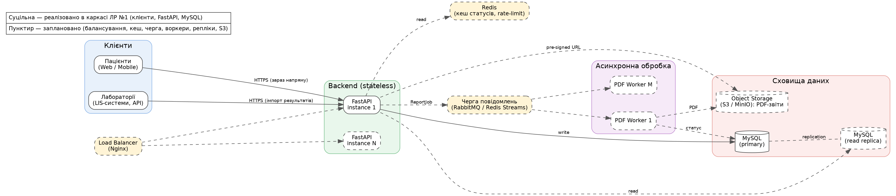

# Архітектура MedLab Aggregator

Джерело діаграми: [`diagrams/architecture.dot`](diagrams/architecture.dot)
(перегенерація: `dot -Tpng -Gdpi=150 architecture.dot -o architecture.png`).

## Взаємодія компонентів

| Компонент | Роль | Стан |
|-----------|------|------|
| **Клієнти** | Пацієнти (web/mobile) переглядають статус і завантажують PDF; лабораторії (LIS) імпортують результати через API | ЛР №1: контракт API, health-check |
| **Load Balancer (Nginx)** | Розподіл трафіку між інстансами API, TLS, rate-limit | заплановано |
| **Backend (FastAPI, stateless)** | REST API, валідація, робота з БД, постановка завдань на генерацію PDF | **реалізовано (каркас)** |
| **MySQL (primary)** | Джерело істини: пацієнти, замовлення, результати, `report_jobs` | **реалізовано** |
| **MySQL (read replica)** | Розвантаження читання (перегляд результатів) | заплановано |
| **Redis** | Кеш статусів замовлень / готових URL, лічильники rate-limit | заплановано |
| **Черга повідомлень** | Буфер між API та воркерами; згладжує ранковий пік | заплановано |
| **PDF Workers** | Асинхронна генерація «важких» PDF, оновлення `report_jobs.status` | заплановано |
| **Object Storage (S3/MinIO)** | Зберігання готових PDF, видача через pre-signed URL | заплановано |

## Ключові сценарії

**1. Перегляд результату (read-heavy).**
Клієнт → LB → API → Redis (hit) → відповідь. При промаху: API → read replica → запис у Redis.

**2. Запит PDF-звіту (write + async).**
1. Клієнт `POST /orders/{id}/report` → API створює `ReportJob(status=pending)` у MySQL і
   кладе повідомлення в чергу; відповідає `202 Accepted` + `job_id`.
2. Воркер бере завдання, генерує PDF, кладе у S3, ставить `status=ready`.
3. Клієнт опитує `GET /report-jobs/{id}` (або отримує push) і отримує pre-signed URL.

## Ключові архітектурні рішення

- **Stateless-бекенд** → горизонтальне масштабування «в один клік» за балансувальником.
- **Async SQLAlchemy + aiomysql** з налаштованим пулом з'єднань (`DB_POOL_SIZE`, `DB_MAX_OVERFLOW`).
- **Чітке розділення read/write шляхів** — заготовка під репліки та кеш.
- **PDF поза HTTP-циклом** → пік навантаження перетворюється на чергу, а не на таймаути.
- **Конфігурація через змінні середовища** (12-factor), `.env.example` у репозиторії.
